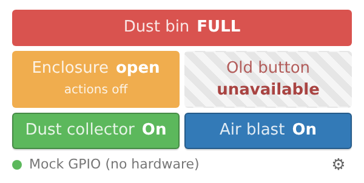
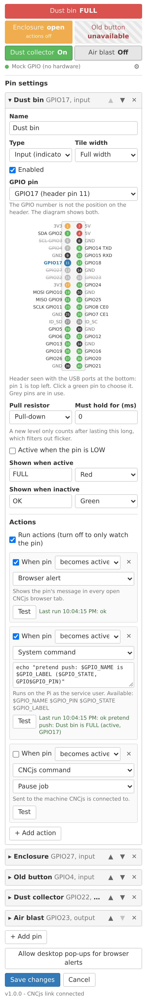

# cncjs-pendant-raspi-gpio

Raspberry Pi GPIO pins as indicators and buttons in [CNCjs](https://github.com/cncjs/cncjs), with actions that run when a pin changes. Everything is set up from a widget inside CNCjs.



Typical uses:

- A "dust bin full" sensor that turns a tile red, pauses the job and sends a push notification.
- A door or enclosure switch shown as an indicator.
- A button in CNCjs that switches a relay on a GPIO pin.

**Version 1.0 is a complete rewrite.** The old single hard-coded button is gone; see [Upgrading from 0.x](#upgrading-from-0x).

## What it does

**Input pins** are shown as indicator tiles. Each state has its own message and color. When a pin changes, any number of actions can run:

| Action | What happens |
| :-- | :-- |
| Browser alert | The tile flashes and the browser tab is flagged in every open CNCjs page. A desktop pop-up is shown where the browser allows it. |
| System command | A shell command runs on the Pi, like a CNCjs event. Use it for `curl` push notifications. |
| CNCjs command | Pause, resume or stop the job, feed hold, cycle start, unlock, homing or reset. |
| G-code | Any G-code is sent to the machine. |

Each action can be switched off on its own, and a pin's actions can be switched off together so the pin is only watched.

**Output pins** are shown as buttons: toggle (click on, click off) or momentary (on for a set time).

Pins keep being watched and actions keep running when no browser is open.

## How it works

There are two parts, because a web page cannot read the Pi's pins:

```
sensor -- GPIO pin --> cncjs-pendant-raspi-gpio (service on the Pi)
                         |-- runs system commands
                         |-- sends commands and G-code through CNCjs
                         |-- keeps its settings in the CNCjs config file
                         '-- serves the widget  <-- CNCjs mount /gpio/ <-- Custom widget
```

The service never opens the serial port. Machine commands go through whichever port CNCjs already has open.

## Requirements

- A Raspberry Pi with the 40-pin header.
- Raspberry Pi OS 13 "Trixie" or later. The service uses the libgpiod **v2** command-line tools (`gpiomon`, `gpioget`, `gpioset`). If they are missing: `sudo apt install gpiod`.
- Node.js 18.3 or later.
- CNCjs running on the same Pi. Tested with CNCjs 1.11.5; older versions need the Custom widget and URL mount points.
- The user that runs the service must be in the `gpio` group (the default `pi` user is).

Nothing is compiled during install, and there is one dependency.

## Install

```bash
git clone https://github.com/cncjs/cncjs-pendant-raspi-gpio.git ~/.cncjs/pendant-raspi-gpio
cd ~/.cncjs/pendant-raspi-gpio
npm install --omit=dev
```

### 1. Start the service

```bash
bin/cncjs-pendant-raspi-gpio --config ~/.cncjs/cncrc.cfg --socket-port 8000
```

`--config` must be the config file CNCjs itself uses (the default is `~/.cncrc`), and `--socket-port` the port CNCjs listens on.

| Option | Default | Meaning |
| :-- | :-- | :-- |
| `-s, --secret <secret>` | from the config file, or `CNCJS_SECRET` | CNCjs secret key |
| `-c, --config <filename>` | `~/.cncrc` | CNCjs config file |
| `--socket-address <address>` | `localhost` | where CNCjs runs |
| `--socket-port <port>` | `8000` | port CNCjs listens on |
| `--access-token-lifetime <time>` | `30d` | seconds, or e.g. `30m`, `12h`, `30d` |
| `--listen-address <address>` | `127.0.0.1` | address the widget server listens on |
| `--listen-port <port>` | `8010` | port the widget server listens on |
| `--mock` | off | run without GPIO hardware |

To start it at boot, edit the paths and port in [systemd/cncjs-pendant-raspi-gpio.service](systemd/cncjs-pendant-raspi-gpio.service), then:

```bash
sudo cp systemd/cncjs-pendant-raspi-gpio.service /etc/systemd/system/
sudo systemctl daemon-reload
sudo systemctl enable --now cncjs-pendant-raspi-gpio
journalctl -u cncjs-pendant-raspi-gpio -f    # log
```

### 2. Mount the widget in CNCjs

Add a mount point that forwards `/gpio` to the service, either on the CNCjs command line:

```bash
cncjs --mount /gpio:http://127.0.0.1:8010/
```

or in the CNCjs config file:

```json
"mountPoints": [
  { "route": "/gpio", "target": "http://127.0.0.1:8010/" }
]
```

Restart CNCjs afterwards.

### 3. Add the widget

In CNCjs, open **Manage Widgets**, turn on **Custom**, click the widget's gear icon and set the URL to `/gpio/` (and any title you like).

## Setting up pins

Click the small gear at the bottom of the widget.



### GPIO number versus header pin

A pin has two numbers. **GPIO17** is the number software uses. **Header pin 11** is where that signal sits on the 40-pin header. The dropdown shows both, and the diagram highlights the pin you chose. Pins that other software is using are greyed out.

A few pins have a second job:

- GPIO2 and GPIO3 have fixed pull-up resistors (I2C). GPIO3 is also the usual power-button pin.
- GPIO14 and GPIO15 are the serial port. Leave them alone if a GRBL hat or the serial console uses them.

### Inputs

| Setting | Meaning |
| :-- | :-- |
| Pull resistor | Pull-down: the pin reads LOW when nothing drives it. Pull-up: it reads HIGH. None: you supply your own resistor. |
| Must hold for (ms) | A new level only counts after it has lasted this long. Use a few seconds for a bin sensor so passing dust does not trigger it. |
| Active when the pin is LOW | Flips which level counts as "active". |
| Shown when active / inactive | Message and color of the tile in each state. |

Actions run when the state changes, not when the service starts.

### System commands

Commands run through `sh` as the user the service runs as. These environment variables are set:

| Variable | Example |
| :-- | :-- |
| `GPIO_NAME` | `Dust bin` |
| `GPIO_PIN` | `17` |
| `GPIO_STATE` | `active` or `inactive` |
| `GPIO_LABEL` | the tile message for the new state, e.g. `FULL` |

A [Pushover](https://pushover.net) notification:

```bash
curl -s --fail-with-body \
  --form-string "token=YOUR_APP_TOKEN" \
  --form-string "user=YOUR_USER_KEY" \
  --form-string "message=$GPIO_NAME: $GPIO_LABEL" \
  https://api.pushover.net/1/messages.json
```

`--fail-with-body` makes a rejected request count as a failure. The **Test** button runs an action straight from the form, before saving, and shows its output.

### Outputs

A toggle button stays on until clicked again. A momentary button turns the pin on for the set time. Timing is approximate (tens of milliseconds); this is not for step pulses or PWM. Outputs are released, and float, whenever the service stops.

### Hiding the status row

To save space, tick **Hide the status row** at the bottom of the settings. The dot and cog disappear and the widget is just the tiles. Press and hold the widget for 1.5 seconds to open the settings again; a line fills across under the tiles while you hold. Holding an output button opens the settings without switching the output.

The row comes back by itself when contact with the service is lost, when there is an error to show, when no pins are enabled, and when the page is opened directly at `/gpio/`.

### Browser alerts

Browsers only allow desktop pop-ups on HTTPS pages or on `localhost`. On a plain `http://` address the alert flashes the tile and flags the tab title instead. For anything you must not miss, add a push notification as a system command.

## Where settings are stored

In the CNCjs config file, under `state.gpio`, next to CNCjs's own events, commands and macros. They are saved through CNCjs, so backing up that one file covers them. They are not part of the browser's workspace export.

## Wiring

GPIO pins work at **3.3 V**. Higher voltages damage the Pi. Most industrial proximity sensors run on 6 to 36 V and switch near their supply voltage, so put an optocoupler module (see the example below), level shifter or voltage divider in between. A pin can only supply a few milliamps; drive relays through a relay module or transistor.

### Example: a 24 V proximity sensor through an optocoupler module

A 10 to 30 V proximity sensor cannot go straight to a GPIO pin. An optocoupler level-converter module (24 V in, 3.3 V out, NPN output) sits in between and keeps the two sides electrically separate.

1. Power the sensor from its own supply and connect its output to one input channel of the module, following the module's labels for NPN or PNP sensors.
2. Connect that channel's output to the GPIO pin.
3. Connect the module's output-side ground to a ground pin on the Pi.

Nothing needs to go to the Pi's 3.3 V pin: the pin's own pull-up resistor supplies the HIGH level.

In the pin settings:

| Setting | Value | Why |
| :-- | :-- | :-- |
| Pull resistor | Pull-up | An NPN output can only pull the pin LOW. The pull-up makes it read HIGH the rest of the time. |
| Active when the pin is LOW | Try it both ways | Which level means "triggered" depends on the sensor (normally open or normally closed) and the module. Hold something in front of the sensor and keep the setting that makes the tile show the right state. |
| Must hold for (ms) | 2000 or more for a bin sensor | Passing dust should not count as "full". |

Then unplug the sensor and look at the tile. With a pull-up, a disconnected input reads HIGH. If HIGH is your "all fine" state, a broken wire or an unpowered sensor looks exactly like "all fine".

Tested with a NOYITO 4-channel optocoupler module (PNP/NPN to NPN, 24 V to 3.3 V) and an M18 capacitive NPN sensor on GPIO22, using Pull-up and "Active when the pin is LOW".

## Security

An action can run any shell command, the same as CNCjs's own Commands and Events. Anyone who can sign in to CNCjs can therefore run commands on the Pi as the service user. The widget server listens on `127.0.0.1` only and every request must carry a valid CNCjs access token.

## Troubleshooting

| Symptom | Cause |
| :-- | :-- |
| The widget says it lost contact and keeps retrying | The service is not running. Check `systemctl status cncjs-pendant-raspi-gpio`. While it is down, CNCjs logs `ECONNREFUSED 127.0.0.1:8010` for each attempt. |
| "Not signed in to CNCjs" | The access token expired, or `--config` points at a different file than the one CNCjs uses. Reload the CNCjs page. |
| A tile says "unavailable" | Hover for the reason. Usually other software holds the pin (`gpioinfo` shows which). |
| "libgpiod v2 tools are required" | The OS is older than Raspberry Pi OS 13. |
| "CNCjs has no machine connected" | A CNCjs command or G-code action ran while no serial port was open in CNCjs. |
| Settings will not save | The service saves through CNCjs; check `--socket-address` and `--socket-port`. |

## Upgrading from 0.x

Version 0.x was a single hard-coded button: presses on GPIO4 sent M7/M8/M9, `$X` or `$H`, and a three-second hold shut the Pi down. All of that is removed.

- There is no `--port`, `--baudrate` or `--controller-type` any more. The service does not open the serial port, which fixes the conflict with GRBL hats on `/dev/ttyAMA0`.
- `onoff`, `serialport` and the other old dependencies are gone, which fixes installs on current Node.js and Raspberry Pi OS.
- For a shutdown button, use the Pi's own `gpio-shutdown` overlay.
- If you ran 0.x under PM2, remove it: `pm2 delete cncjs-pendant-raspi-gpio`.

## Development

```bash
npm install
npm test                                           # no hardware needed
bin/cncjs-pendant-raspi-gpio --mock --secret dev   # widget server with pretend pins
```

In mock mode, set an input level with `POST /api/mock/<gpio>` and the body `{"level": 1}`. Saving settings still needs a running CNCjs, because that is where they are stored.

## License

MIT
